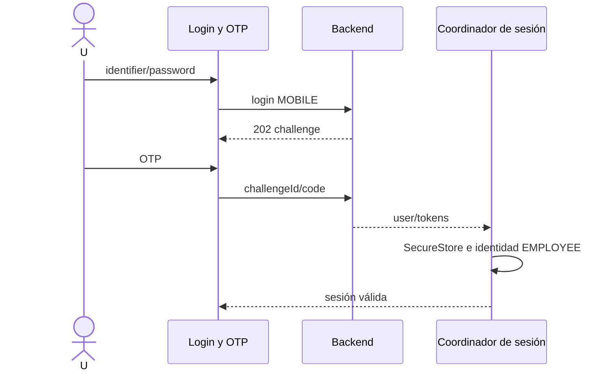
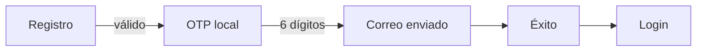
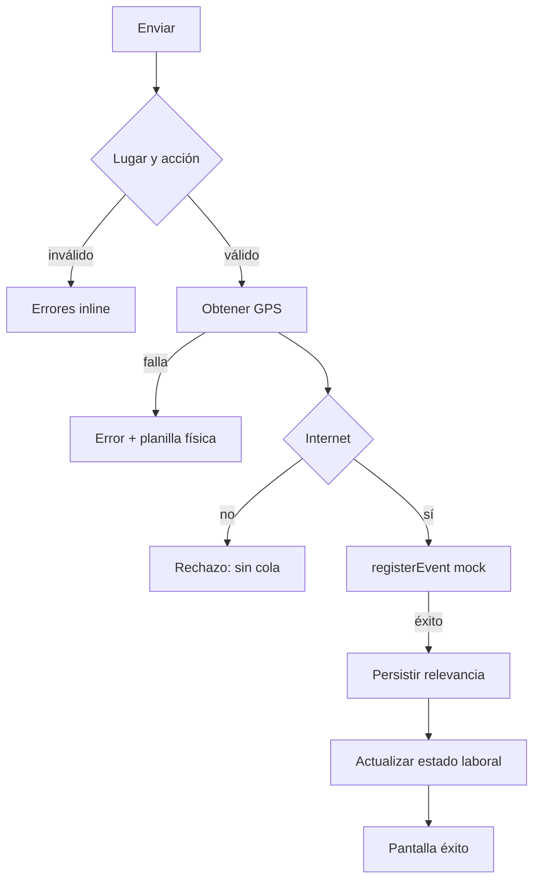
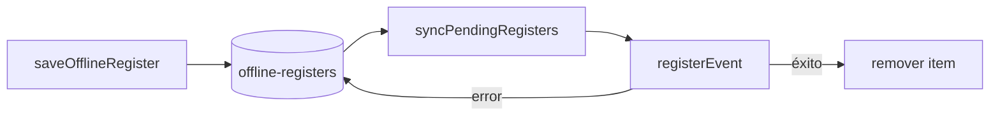
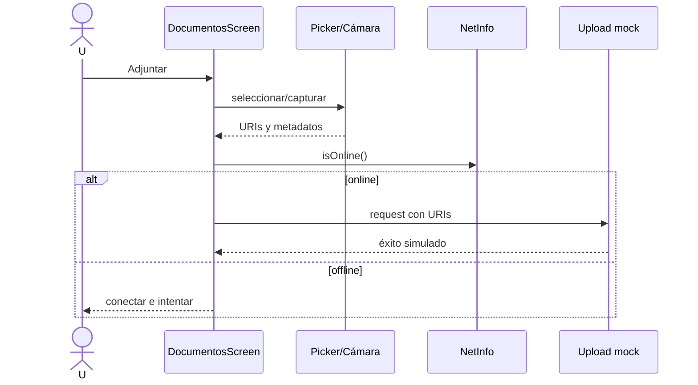

# Flujos de usuario

## 1. Arranque y sesión

`app/index.tsx` valida URL API antes de navegar. Configuración ausente/inválida muestra error accionable. Con URL válida ejecuta bootstrap; spinner hasta completar. Se elimina la sesión mock AsyncStorage; solo se publica identidad tras validar SecureStore y `/profile` protegido EMPLOYEE. Fallos impiden restaurar identidad local sin validación. AuthStore vive en memoria; tokens únicamente SecureStore. Evidencia portátil y límites API/Android en docs 06/09.

## 2. Login email/legajo y OTP

1. Login exige identifier/password no vacíos, sin aplicar política de alta a contraseña existente.
2. POST `/auth/login` con client=MOBILE responde 202 challenge; no autentica.
3. VerifyCodeScreen envía challengeId/code a `/auth/otp/verify`; reenvío usa endpoint/cooldown servidor.
4. Solo respuesta válida con usuario EMPLOYEE/tokens instala sesión segura y AppNavigator. Errores servidor se muestran sin éxito ficticio.
5. Refresh JSON rotativo single-flight; respuesta ambigua exige relogin. Logout limpia de inmediato y confirma revocación solo con respuesta servidor; fallos visibles permiten reintentar.

## 3. Google

El botón activo informa Google no configurado. No usa selector de cuentas ficticias ni instala identidad. OAuth/OTP Google real permanece pendiente de otra feature.

## 4. Registro

1. Login → Registrarse.
2. Se solicitan nombre, apellido, legajo, DNI, email, password y su confirmación, teléfono, domicilio, provincia/site y fecha de nacimiento (DD/MM/AAAA).
3. Validaciones locales bloquean campos inválidos: confirmación exacta de contraseña, fecha calendario válida y no futura; barras de fecha automáticas. El ojo de cada contraseña es independiente; Siguiente recorre los campos y abre provincia desde domicilio. El hook `useKeyboardFormScroll` intenta mantener visible el campo con teclado nativo; sus pruebas portátiles de geometría están conformes (ver QA).
4. Si son válidos, **los datos no se envían ni almacenan**.
5. Se abre OTP WhatsApp; cualquier código de 6 dígitos avanza.
6. Pantalla “Te enviamos un correo” → Entendido.
7. Éxito temporizado 2,5 s → login.

`services/registerService.ts` no registra usuarios: registra eventos laborales y no es usado por RegisterScreen.

## 5. Recuperación

Login → olvidé contraseña → valida email → comprueba Internet → servicio mock espera 1,5 s y retorna éxito → confirmación neutral (“si existe cuenta...”) → volver. Sin token, correo ni nueva contraseña.

## 6. Navegación autenticada

Tabs manuales: documentos, home, perfil. Home incluye header; la pantalla de éxito de marcación oculta tabs y retorna automáticamente a los 2 s.

## 7. Selección de lugar

Al montar Home se cargan en paralelo lugares mock, lugar reciente, favoritos e historial. Se ordenan por relevancia y se preselecciona el reciente de la franja. Preferencias usan AsyncStorage por propietario y descartan lecturas de una cuenta anterior; la UI Home todavía conserva la actualización optimista y requiere su migración de dominio.

## 8. Entrada/salida/ausencia

1. Elegir lugar y acción; observación opcional.
2. Para ausencia puede elegirse motivo, pero no se envía.
3. Solicitar permiso foreground y ubicación High; timeout 120 s.
4. Si GPS falla, detener y recomendar planilla física.
5. Verificar conectividad; offline se rechaza.
6. Crear `RegisterRequest` con workplaceId, acción, observación, timestamps y coordenadas.
7. `registerEvent` simula 1 s y éxito.
8. Guardar lugar reciente/usado; entrada pone `isWorking=true`, salida `false`.
9. Mostrar éxito y resetear selección al volver.

## 9. Cola offline

Es diseño existente pero **no alcanzable**: Home tiene import comentado; tampoco hay suscripción activa que invoque sync.

## 10. Carga de planilla

Documentos → abrir modal → opcionalmente elegir lugar → cámara o galería múltiple → quitar imágenes → enviar. Requiere al menos una imagen e Internet. Construye `months: []`, envía URIs al mock, resetea y muestra éxito. El botón no exige lugar y no hay transferencia binaria.

## 11. Documentación de contingencia

Documentos → modal → selector de documentos o cámara → filtra extensiones → permite quitar → exige ≥1 archivo → Internet → request con `workplaceId: null` → mock → éxito. No valida tamaño, duplicados ni cantidad.

## 12. Perfil y logout

Perfil muestra `userProfile` fijo (Gina Tini), no `authStore.user`. Los campos son solo lectura. Logout pide confirmación y llama a `authService.logout()`/coordinador: invalida identidad de inmediato y ejecuta `resetAccount()` sobre `useAppStore`. El root vuelve a AuthNavigator; fallos de borrado/revocación quedan visibles para reintentar. La revocación remota solo se confirma con respuesta servidor. Detalles de persistencia, aislamiento y aceptación real en docs 06/09.
