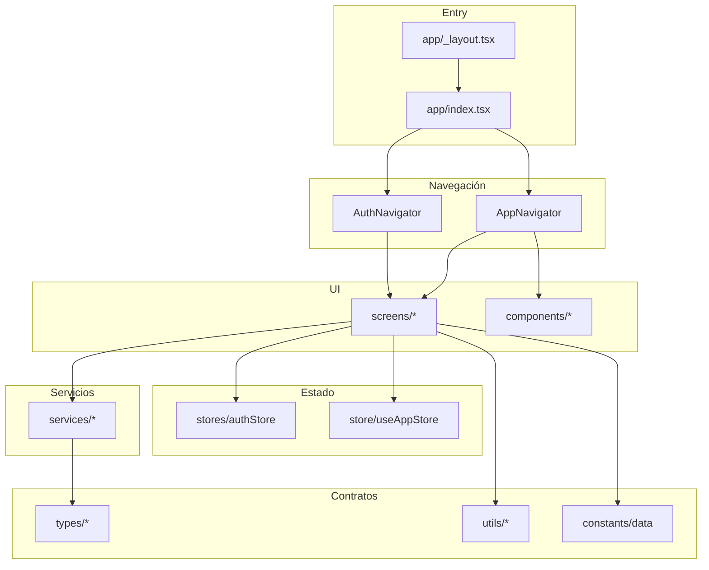
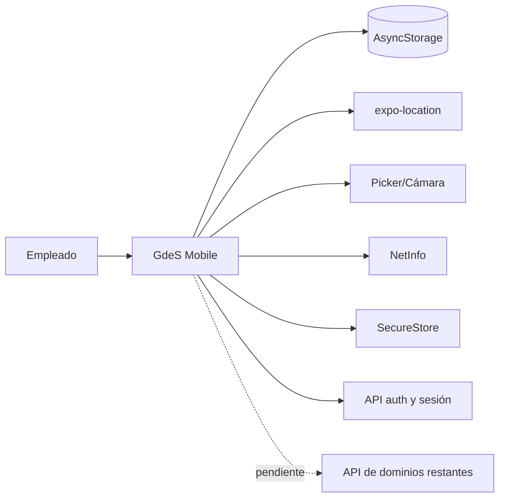

# Arquitectura técnica

## Stack

- **Expo** `~57` con `expo-router` como entrypoint (`package.json`, `main: expo-router/entry`).
- **React** `19.2.3`, **React Native** `0.86.3`, New Architecture habilitada (`app.json`).
- **NativeWind 4** + Tailwind 3 para estilos (`babel.config.js`, `tailwind.config.js`, `global.css`).
- **Zustand 4** para estado en memoria; SecureStore para credenciales, AsyncStorage para preferencias por cuenta e invalidación no sensible.
- **Expo modules**: `expo-location`, `expo-image-picker`, `expo-document-picker`, `expo-linking`, `expo-secure-store`.
- **@react-native-community/netinfo** para conectividad.
- **TypeScript** estricto, alias `@/*` (`tsconfig.json`).

## Capas

Aunque el proyecto usa expo-router, el ruteo por archivos se limita a montar `app/index.tsx`; toda la navegación real es **condicional por estado** dentro de navegadores propios.

## Entrypoints

- `app/_layout.tsx`: `SafeAreaProvider`, `StatusBar`, `Stack` con headers ocultos y fondo `#EDF2F5`; importa `global.css`.
- `app/index.tsx`: valida configuración API, inicia bootstrap servidor y decide Auth vs App; spinner durante validación, key de AppNavigator por usuario.

## Estado

Dos stores separados:

| Store | Persistencia | Contenido | Consumidores |
|---|---|---|---|
| `stores/authStore.ts` | En memoria; coordina sessionCoordinator | identidad inglesa, `isAuthenticated`, `hydrated`, error | index y navegadores |
| `store/useAppStore.ts` | En memoria | acción, lugar, observación, `isWorking`, `user` interno | HomeScreen, AppNavigator |

`useAppStore.user` es un modelo `{id,name}` distinto y sin uso real. La marcación no se persiste.

## Persistencia local

| Clave | Servicio | Dato |
|---|---|---|
| `gdes.secure-session.v1` | tokenRepository / SecureStore | JSON versionado con identidad y par de tokens, sin respaldo/extracción |
| `gdes.secure-session.invalidated.v1` | tokenRepository / AsyncStorage | Marca no sensible, impide restaurar credenciales invalidadas |
| `gdes-account-v1:<ownerId>:<namespace>` | localPreferences / AsyncStorage | Favoritos/usados/recientes aislados por cuenta |
| `offline-registers:v1:<ownerId>` | offlineRegisterService / AsyncStorage | Infraestructura inactiva con dueño |
| `offline-registers` y preferencias legacy | AsyncStorage | Preservados sin atribuir dueño ni enviar |

La sesión mock `gdes-auth-session` se elimina al bootstrap; no se lee un booleano persistido como autorización. Coordinador serializa persistencia, usa epoch/abort para respuestas tardías y refresh single-flight; detalle y límites de fallos de almacenamiento en doc 06.

## Red y dispositivo

- `networkService.isOnline` exige `isConnected` e `isInternetReachable`; ante error asume offline.
- `subscribeToConnectivity` detecta transición offline→online, pero ningún módulo la suscribe.
- `locationService` fuerza permisos foreground y precisión alta con timeout de 120 s y errores tipados.

## Diagrama de contexto

## Decisiones observadas

- HTTP común y coordinador de sesión reales; servicios de dominios restantes simulan latencia.
- Tipos locales (`types/api.ts`, `types/document.ts`) describen el mock; requieren migración al contrato aprobado (ver doc 05).
- La aceptación API/OTP/Android de auth sigue pendiente; pruebas portátiles no certifican dispositivos ni entrega del proveedor.

## Riesgos estructurales

- Datos de lugares duplicados en tres fuentes (`workplaceService`, `types/document`, `constants/data`) con IDs distintos.
- Dos stores y dos modelos de usuario generan ambigüedad sobre la identidad vigente.
- Navegación manual sin historial nativo dificulta deep links y back del sistema.
