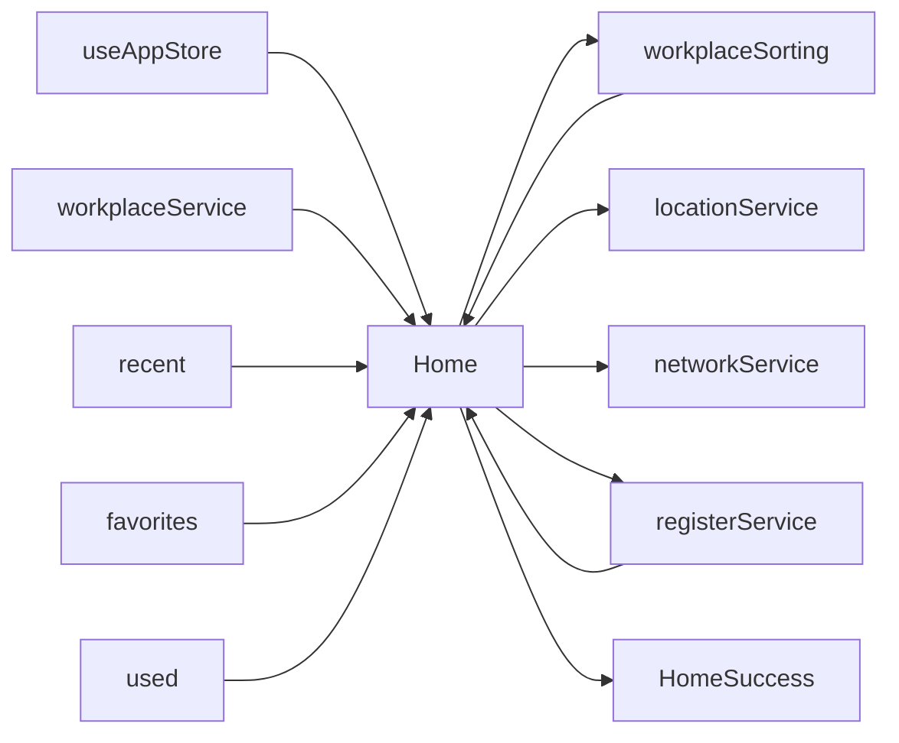

# Servicios, datos y contratos

## Servicios

| Servicio | Archivo | Naturaleza | Notas |
|---|---|---|---|
| authService | `services/authService.ts` | Mock | Credenciales fijas; delay 800 ms. |
| registerService | `services/registerService.ts` | Mock | `registerEvent` éxito; `registerEventWithError` para pruebas. |
| workplaceService | `services/workplaceService.ts` | Mock | 3 lugares; delay 800 ms. |
| favoriteWorkplaceService | `services/favoriteWorkplaceService.ts` | Local | CRUD de favoritos en AsyncStorage. |
| recentWorkplaceService | `services/recentWorkplaceService.ts` | Local | Lugar por franja mañana/tarde. |
| usedWorkplaceService | `services/usedWorkplaceService.ts` | Local | Historial con más reciente al frente. |
| locationService | `services/locationService.ts` | Real dispositivo | GPS High, timeout 120 s, errores tipados. |
| networkService | `services/networkService.ts` | Real dispositivo | `isOnline` y `subscribeToConnectivity`. |
| offlineRegisterService | `services/offlineRegisterService.ts` | Local, inactivo | Cola `offline-registers`. |
| syncService | `services/syncService.ts` | Inactivo | Sincroniza cola contra mock. |
| uploadDocumentService | `services/uploadDocumentService.ts` | Mock | Planillas; delay 1 s. |
| documentService | `services/documentService.ts` | Mock | Contingencia; delay 1,5 s. |

## Integración aprobada y disponibilidad

Los acuerdos vigentes viven en [contratos-api](arquitectura/contratos-api.md). El detalle HTTP de **diseño** se consulta en `backend_api_gdes/docs/03-contratos-api.md`; ante divergencia manda el contrato común. Esta separación preserva requisitos aprobados sin presentar mocks como API operativa.

La app no contiene cliente HTTP ni URL de API. Backend registra solo `HealthController` en `src/app.module.ts`; auth, asistencia, catálogos, perfil y uploads de negocio aún no están montados. Las siguientes migraciones están **aprobadas y pendientes**, cubiertas por F-010 (`feature_list.json`, `pending`, sin task spec):

| Tema | Mock vigente | Integración pendiente y motivo |
|---|---|---|
| Identidad y sesión | `AuthUser { id, nombre, apellido, email, legajo }`, sin tokens/rol; email+password autentica inmediatamente | Campos `firstName`, `lastName`, `employeeId`, `role`; solo `EMPLOYEE` en mobile (`ROLE_NOT_ALLOWED` para otros). Login password/Google responde challenge 202; OTP WhatsApp real emite tokens; refresh mobile en JSON y tokens en SecureStore, para verificar identidad y renovar sesión. Registro requiere OTP y verificación email por magic link, sin tokens al completar OTP; `EMAIL_NOT_VERIFIED` bloquea login. |
| Marcación | `action: entrada/salida/ausencia`, `timestamp`; respuesta `success/message/registrationId` | `POST /api/v1/attendance/events`: `type: CHECK_IN/CHECK_OUT/ABSENCE`, `occurredAt`, `clientRequestId` estable en reintentos, GPS y `absenceReason` opcional solo para ABSENCE; respuesta `{ data: { eventId, recordId, message } }`. Los eventos atómicos permiten proyección diaria e idempotencia. |
| Respuestas y errores | Sin envelope y `ApiError` sin `retryable` | `{ data }`, listados paginados `{ data, pagination }`; `{ error: { code, message, retryable } }`, códigos en inglés/mensajes en español, para manejar errores y reintentos de forma coherente. |
| Estado laboral | `useAppStore.isWorking` en memoria | `GET /api/v1/attendance/status` deriva estado servidor; evita perderlo al reiniciar. |
| Lugares | `active` y datos fijos distintos por pantalla | `GET /api/v1/workplaces` catálogo activo y DTO del diseño HTTP; usar IDs reales y una fuente común. El DTO diseñado trae `clientName`, coordenadas y radio; no inferir disponibilidad por existir en docs. |
| Planillas | `workplace`, `months: []`, URIs locales | `POST /api/v1/timesheets` multipart con `workplaceId` requerido, `month`, `year`, `files`; devuelve `timesheetIds`. Es necesario enviar binarios y período, y no solo renombrar el campo. |
| Documentos | `workplaceId: null`, metadatos y URIs | `POST /api/v1/documents` multipart con `type`, `workplaceId` nullable y archivos; devuelve `documentIds`. Falta selector/tipo contractual y transferencia real. |
| Perfil | `constants/data.ts` fijo | `GET /api/v1/profile` y campos ingleses; falta definir quién carga `cuil`, `hireDate`, `position`, que permanecen nullable. |

Los uploads aprobados tienen máximo **20 MiB por archivo y 10 archivos por request**, validación de contenido/extensión y lote atómico. La UI actual no aplica esos límites. No se agrega dirección textual/Place ID a Workplace: la selección Google Maps es decisión de Admin y no habilita nuevas capacidades mobile.

### Offline y motivos: requisitos y preguntas abiertas

La ventana aprobada usa recepción **del servidor**: `receivedAt - occurredAt <= 24 h`; exactamente 24 h se acepta y más se rechaza. Aún falta activar cola/sync y UX de rechazo definitivo. El código de diseño backend es `422 ATTENDANCE_EVENT_TOO_OLD`, `retryable=false`; faltan implementación y pruebas de frontera. Timestamps futuros/clock skew siguen sin decisión. `syncService.ts` conserva todo error para reintento y no distingue errores terminales: requiere migración además de conectar el listener.

Los valores UI `enfermedad/franco/otros` (`HomeScreen.tsx`) no equivalen automáticamente al enum Admin `ILLNESS/VACATION/LEAVE/ART/OTHER` (`admin_web_app/src/types/records.ts`). Consumir catálogo común y confirmar el significado de **franco**, sin inventar equivalencia.

## Tipos del mock actual (evidencia de código, no contrato HTTP)

### Marcación (`types/api.ts`)

```ts
RegisterAction = "entrada" | "salida" | "ausencia"
RegisterRequest { workplaceId; action; observation?; timestamp; latitude; longitude; accuracy; locationTimestamp }
RegisterResponse { success; message; registrationId? }
ApiError { code; message }
```

`observation` viaja, pero el motivo de ausencia no se incorpora al request en `HomeScreen`.

### Documentos (`types/document.ts`)

```ts
DocumentUploadRequest { workplace; months: string[]; files: string[]; uploadedAt }
DocumentUploadResponse { success; message; documentId? }
SelectedFile { uri; name; type; size }
ContingencyUploadRequest { workplaceId: string|null; files: SelectedFile[]; uploadedAt }
ContingencyUploadResponse { success; message }
ALLOWED_EXTENSIONS = pdf,jpg,jpeg,png,docx,doc,txt
```

Planilla envía `months: []` fijo y URIs de imagen. Contingencia envía `workplaceId: null`.

### Workplace (`types/workplace.ts`)

```ts
Workplace { id; name; siteId; siteName; active }
```

### Sesión (`stores/authStore.ts`)

```ts
AuthUser { id; nombre; apellido; email; legajo }
```

## Datos mock

- **Lugares Home**: wp-1/2/3 (Hospital Central/Norte, Clínica San José) en `workplaceService.ts`.
- **Lugares documentos**: wp-001/002/003 con nombres similares en `types/document.ts`.
- **Lugares legacy**: `constants/data.ts` (Oficina Central, etc.) no usados por Home.
- **Perfil**: `userProfile` (Gina Tini) en `constants/data.ts`.
- **Cuentas Google**: `googleAccounts` en `constants/data.ts`.
- **Provincias**: seis valores en `constants/data.ts`.
- **documents/months**: definidos en `constants/data.ts` sin consumidor de negocio.

## Manejo de errores

- Servicios locales atrapan y retornan valores neutros (`[]`, false) sin propagar.
- `locationService` lanza `LocationError` tipado consumido por Home.
- Servicios mock nunca fallan salvo `registerEventWithError`.
- La UI traduce fallas a mensajes que sugieren planilla física cuando aplica.

## Flujo de datos de marcación


