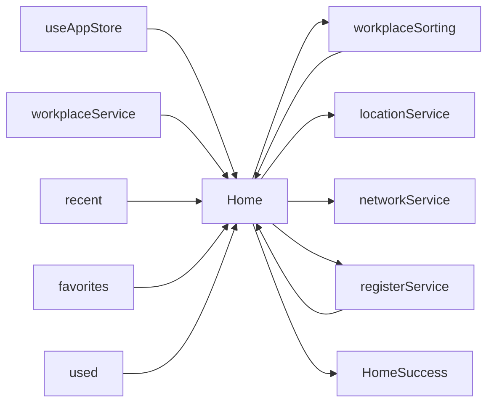

# Servicios, datos y contratos

## Servicios

| Servicio | Archivo | Naturaleza | Notas |
|---|---|---|---|
| httpClient | `services/httpClient.ts` | Infraestructura implementada | Configuración validada en arranque; transporte JSON consumido por sesión, sin fallback mock. |
| authService | `services/authService.ts` | API, portátil | Login/OTP/SecureStore/bootstrap/refresh/logout; aceptación B-03/Android pendiente. |
| registerService | `services/registerService.ts` | Mock | `registerEvent` éxito; `registerEventWithError` para pruebas. |
| workplaceService | `services/workplaceService.ts` | Mock | 3 lugares; delay 800 ms. |
| favoriteWorkplaceService | `services/favoriteWorkplaceService.ts` | Local | CRUD local por propietario en AsyncStorage. |
| recentWorkplaceService | `services/recentWorkplaceService.ts` | Local | Lugar por franja mañana/tarde y propietario. |
| usedWorkplaceService | `services/usedWorkplaceService.ts` | Local | Historial por propietario con más reciente al frente. |
| locationService | `services/locationService.ts` | Real dispositivo | GPS High, timeout 120 s, errores tipados. |
| networkService | `services/networkService.ts` | Real dispositivo | `isOnline` y `subscribeToConnectivity`. |
| offlineRegisterService | `services/offlineRegisterService.ts` | Local, inactivo | Cola nueva por propietario; `offline-registers` legacy preservada sin atribución. |
| syncService | `services/syncService.ts` | Inactivo | Sincroniza cola contra mock. |
| uploadDocumentService | `services/uploadDocumentService.ts` | Mock | Planillas; delay 1 s. |
| documentService | `services/documentService.ts` | Mock | Contingencia; delay 1,5 s. |

## Integración aprobada y disponibilidad

Los acuerdos vigentes viven en [contratos-api](arquitectura/contratos-api.md). El detalle HTTP de **diseño** se consulta en `backend_api_gdes/docs/03-contratos-api.md`; ante divergencia manda el contrato común. Esta separación preserva requisitos aprobados sin presentar mocks como API operativa.

El arranque (`app/index.tsx`) valida `EXPO_PUBLIC_API_BASE_URL` con `getApiConfigurationError()` del cliente HTTP antes de habilitar AuthNavigator/AppNavigator. Ausencia o URL inválida muestra error accionable y bloquea navegación, incluso con sesión local persistida. Sesión ya consume el transporte; los demás servicios de negocio siguen mock. Backend registra `StructureModule`, `AuthModule`, `UsersModule`, `AttendanceModule`, `DashboardModule` y `FilesModule`, además de health (`backend_api_gdes/src/app.module.ts`). Su montaje no certifica entorno local ni pruebas Android. Las siguientes migraciones están **aprobadas y pendientes**, cubiertas por F-010 como agregador `pending` y por F-011–F-016 en `feature_list.json` (specs de integración locales; F-011 y F-012 portátiles conformes por revisión independiente, pendientes de aceptación API/Android):

| Tema | Estado vigente | Integración pendiente y motivo |
|---|---|---|
| Identidad y sesión | Identidad inglesa EMPLOYEE; login→challenge→OTP real, SecureStore, bootstrap /profile, refresh single-flight y logout; sin credenciales fijas | Parte portátil conforme por reviewer; validación real B-03/Android pendiente. Google, registro/email y recuperación corresponden a M-03. Detalle de implementación y límites en [seguridad](06-autenticacion-y-seguridad.md). |
| Marcación | `action: entrada/salida/ausencia`, `timestamp`; respuesta `success/message/registrationId` | `POST /api/v1/attendance/events`: `type: CHECK_IN/CHECK_OUT/ABSENCE`, `occurredAt`, `clientRequestId` estable en reintentos, GPS y `absenceReason` opcional solo para ABSENCE; respuesta `{ data: { eventId, recordId, message } }`. Los eventos atómicos permiten proyección diaria e idempotencia. |
| Respuestas y errores | Servicios mock sin envelope; el transporte común ya expone `retryable` | `{ data }`, listados paginados `{ data, pagination }`; `{ error: { code, message, retryable } }`, códigos en inglés/mensajes en español, para manejar errores y reintentos de forma coherente. |
| Estado laboral | `useAppStore.isWorking` en memoria | `GET /api/v1/attendance/status` deriva estado servidor; evita perderlo al reiniciar. |
| Lugares | `active` y datos fijos distintos por pantalla | `GET /api/v1/workplaces` catálogo activo y DTO del diseño HTTP; usar IDs reales y una fuente común. El DTO diseñado trae `clientName`, coordenadas y radio; no inferir disponibilidad por existir en docs. |
| Planillas | `workplace`, `months: []`, URIs locales | `POST /api/v1/timesheets` multipart con `workplaceId` requerido, `month`, `year`, `files`; devuelve `timesheetIds`. Es necesario enviar binarios y período, y no solo renombrar el campo. |
| Documentos | `workplaceId: null`, metadatos y URIs | `POST /api/v1/documents` multipart con `type`, `workplaceId` nullable y archivos; devuelve `documentIds`. Falta selector/tipo contractual y transferencia real. |
| Perfil | `constants/data.ts` fijo | `GET /api/v1/profile` y campos ingleses; `cuil`, `hireDate`, `position` permanecen nullable y Admin puede actualizarlos conforme al contrato de empleados; mobile solo los muestra, sin inventar datos. |

Los uploads aprobados tienen máximo **20 MiB por archivo y 10 archivos por request**, validación de contenido/extensión y lote atómico. La UI actual no aplica esos límites. No se agrega dirección textual/Place ID a Workplace: la selección Google Maps es decisión de Admin y no habilita nuevas capacidades mobile.

### Offline y motivos: requisitos y preguntas abiertas

La ventana aprobada usa recepción **del servidor**: `receivedAt - occurredAt <= 24 h`; exactamente 24 h se acepta y más se rechaza con `422 ATTENDANCE_EVENT_TOO_OLD`, `retryable=false`. La API backend publica esta conducta y valida `clientSentAt` fresco con adelanto máximo de dos minutos; offline conserva `occurredAt`/GPS originales. Online, sin `clientSentAt`, la hora efectiva la asigna servidor. Falta integrar y verificar la conducta desde mobile; los límites temporales aún abiertos permanecen en el contrato común. `syncService.ts` conserva todo error para reintento y no distingue errores terminales: requiere migración además de conectar el listener.

Los valores UI `enfermedad/franco/otros` (`HomeScreen.tsx`) no equivalen automáticamente al enum Admin `ILLNESS/VACATION/LEAVE/ART/OTHER` (`admin_web_app/src/types/records.ts`). **Franco** significa día o jornada libre sin obligación de prestar servicios; su significado está ratificado. Consumir catálogo común y alinear su representación técnica pendiente, sin inventar equivalencia a VACATION/LEAVE ni atribuir incumplimiento.

## Tipos del mock actual (evidencia de código, no contrato HTTP)

### Marcación (`types/api.ts`)

```ts
RegisterAction = "entrada" | "salida" | "ausencia"
RegisterRequest { workplaceId; action; observation?; timestamp; latitude; longitude; accuracy; locationTimestamp }
RegisterResponse { success; message; registrationId? }
ApiError { code; message; retryable }
```

`observation` viaja, pero el motivo de ausencia no se incorpora al request en `HomeScreen`.

### Documentos (`types/document.ts`)

```ts
DocumentUploadRequest { workplace; months: string[]; files: string[]; uploadedAt }
DocumentUploadResponse { success; message; documentId? }
SelectedFile { uri; name; type; size }
ContingencyUploadRequest { workplaceId: string|null; files: SelectedFile[]; uploadedAt }
ContingencyUploadResponse { success; message }
ALLOWED_EXTENSIONS = pdf,jpg,jpeg,png,docx,doc,txt
```

Planilla envía `months: []` fijo y URIs de imagen. Contingencia envía `workplaceId: null`.

### Workplace (`types/workplace.ts`)

```ts
Workplace { id; name; siteId; siteName; active }
```

### Sesión implementada (`services/sessionCoordinator.ts`)

```ts
AuthUser { id; firstName; lastName; email; employeeId; role: "EMPLOYEE" }
```

## Datos mock

- **Lugares Home**: wp-1/2/3 (Hospital Central/Norte, Clínica San José) en `workplaceService.ts`.
- **Lugares documentos**: wp-001/002/003 con nombres similares en `types/document.ts`.
- **Lugares legacy**: `constants/data.ts` (Oficina Central, etc.) no usados por Home.
- **Perfil**: `userProfile` (Gina Tini) en `constants/data.ts`.
- **Cuentas Google**: `googleAccounts` en `constants/data.ts`, modal inactivo; no autentican.
- **Provincias**: seis valores en `constants/data.ts`.
- **documents/months**: definidos en `constants/data.ts` sin consumidor de negocio.

## Manejo de errores

- Preferencias/cola propagan errores de persistencia; lecturas de generaciones anteriores se descartan.
- `locationService` lanza `LocationError` tipado consumido por Home.
- Servicios mock nunca fallan salvo `registerEventWithError`.
- La UI traduce fallas a mensajes que sugieren planilla física cuando aplica.

## Flujo de datos de marcación




## Cliente HTTP común (infraestructura implementada)

`services/httpClient.ts` exporta `httpClient.request<T>(path, options)` y `createHttpClient({ baseUrl, fetch?, timeoutMs?, development? })` para pruebas y sesión. Paths relativos (`profile` o `/profile`) conservan `/api/v1`; rechaza hosts alternativos, traversal y prefijo duplicado. La configuración se comprueba al render inicial de `app/index.tsx`, sin request ni dependencia de hidratación, y se vuelve a validar en cada solicitud. Ausencia/configuración inválida conserva `HttpError` con `INVALID_CONFIG`, muestra instrucciones para configurar `.env` y reiniciar Metro/app, y bloquea navegación sin mock. URL válida habilita el flujo vigente de hidratación/sesión; no demuestra disponibilidad de API. HTTP se admite solo en desarrollo, HTTPS en release.

El resultado `{ status, data, pagination? }` desempaqueta el envelope; `data` es undefined en 204 y 202 conserva su payload. Cada servicio validará su DTO: el genérico no prueba la forma de `T`. Body se serializa como JSON, con Accept/Content-Type y headers por request para autorización; multipart corresponde a M-06. `HttpError` expone `code`, `message`, `retryable` y `status` si existe: preserva el error contractual o diferencia `INVALID_CONFIG`, `INVALID_RESPONSE`, `NETWORK_ERROR`, `TIMEOUT` (15 s por defecto) y `CANCELLED`. El timeout abarca lectura de body, ambos abortan fetch y limpian timers/listeners. El transporte no reintenta por sí mismo; M-02 coordina sesión/renovación mediante authenticatedRequest según [seguridad](06-autenticacion-y-seguridad.md). Cada dominio decide sus reintentos usando también status.
