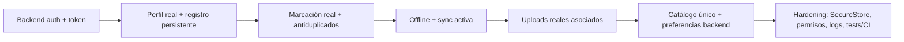

# Deuda técnica y roadmap

Prioridad por impacto en correctitud, seguridad y mantenibilidad. Cada ítem cita evidencia.

## Crítico

1. **Aceptación real de sesión pendiente.** Login/OTP/SecureStore/refresh/logout implementados en M-02 con pruebas portátiles; falta fixture B-03/API y Android físico, incluida persistencia nativa.
2. **Google login sin OAuth.** Opción muestra no configurado y ya no instala usuario falso; integrar proveedor en M-03.
3. **OTP de registro mock.** Login ya exige verify backend; registro conserva validación local hasta M-03 y no instala sesión.
4. **Recuperación simulada.** `passwordRecoveryService` siempre retorna éxito. Falta token, correo y cambio de contraseña.
5. **Cargas de archivos simuladas.** `documentService`/`uploadDocumentService` no transfieren binarios. Implementar upload real (multipart/firmado) y asociación a usuario/lugar (TODOs en `documentService.ts`).

## Alto

6. **Perfil desconectado de la sesión.** `PerfilScreen` usa `userProfile` fijo (Gina Tini) en vez de `authStore.user`. Mostrar el usuario autenticado real.
7. **Validación externa login email/legajo pendiente.** Cliente envía identifier contractual y contraseña existente al servidor; falta prueba B-03 real.
8. **Marcación offline inactiva.** `offlineRegisterService`/`syncService` existen, pero Home rechaza sin Internet y el import está comentado (`HomeScreen.tsx`). Conectar cola + `subscribeToConnectivity` o retirar el código muerto.
9. **Motivo de ausencia no persiste.** Se captura en estado local pero no se agrega a `RegisterRequest`. Migrar al `absenceReason` ya aprobado; alinear representación técnica de “franco” como jornada libre con catálogo, sin inventar equivalencia a VACATION/LEAVE (doc 05).
10. **Catálogos de lugares duplicados/incoherentes.** IDs distintos entre `workplaceService` (wp-1..3), `types/document` (wp-001..003) y `constants/data`. Unificar fuente única.
11. **Aceptación runtime Android pendiente.** Peers React/React DOM 19.2.3 alineados, instalación limpia y prebuild verificados; faltan SDK/JDK/adb, APK instalado y smoke LAN desde teléfono (docs 08/09). npm reporta 26 avisos de seguridad pendientes de evaluar; no se aplicaron upgrades indiscriminados.

## Medio

12. **Dos stores y dos modelos de usuario.** `store/useAppStore` vs `stores/authStore`; `useAppStore.user` sin uso. Unificar identidad y ubicación de stores.
13. **`isWorking` volátil.** Vive solo en memoria; se pierde al reiniciar y no deriva del backend.
14. **Aceptación aislamiento en dispositivo pendiente.** Logout ya reinicia marcación y separa preferencias por cuenta; verificar reinicio/cambio de cuenta real.
15. **Favoritos sin rollback.** Actualización optimista sin revertir si AsyncStorage falla (`HomeScreen.handleToggleFavorite`).
16. **Sin límites en documentación.** No hay tope de tamaño, cantidad ni validación de duplicados (`DocumentosScreen`).
17. **GPS y requests en logs.** `console.log` con coordenadas y payloads en Home/servicios.
18. **Pantallas/componentes sin uso.** `LoginSuccessScreen`, `ForgotSuccessScreen`, y posibles `login-form`/`login-header`/`input-field`/`button`/`google-icon`. Confirmar y depurar.

## Bajo

19. **Permisos nativos por verificar en dispositivo.** Configurados GPS/cámara/pickers y cadenas de uso; prebuild verificado, falta smoke autorizado/denegado/cancelado.
20. **Sin lint ni CI.** Scripts test/typecheck y suites registro/transporte pasan; geometría simulada no reemplaza teclado Android/iOS físico (doc 09).
21. **`registerEventWithError` de prueba en producción del bundle.** Evaluar aislar utilidades de test.
22. **Franja horaria rígida.** Solo mañana/tarde con corte fijo (`recentWorkplaceService`).
23. **Mezcla de idiomas.** Comentarios/logs en inglés y UI en español; definir criterio.

## TODOs presentes en el código

- `HomeScreen.tsx`: almacenamiento y sincronización offline futura (import comentado).
- `AuthNavigator.tsx`: integrar Google real en M-03 sin restablecer bypass OTP.
- `documentService.ts`: endpoint real, asociación a usuario y a workplace.
- `uploadDocumentService.ts`: llamada real de carga.
- `passwordRecoveryService.ts`: endpoint real de recuperación.
- `workplaceService.ts`, `usedWorkplaceService.ts`, `workplaceSorting.ts`, `recentWorkplaceService.ts`: reemplazar datos/ranking local por backend.
- `favoriteWorkplaceService.ts`: sincronizar favoritos con backend.
- `validations.ts`: el TODO de reutilizar password ya está cumplido en registro; cambio/recuperación reales y política servidor siguen pendientes.

## Integración aprobada pendiente (F-010)

F-010 sigue `pending` como agregador en `feature_list.json`; F-011–F-016 descomponen M-01–M-06 autorizados, con specs locales en `docs/tasks/` y F-011/F-012 portátiles conformes por revisión independiente, pendientes de aceptación API/Android. La continuación vigente se limita a M-02 y no inicia las features restantes. El detalle consolidado está en [doc 05](05-servicios-datos-y-contratos.md): identidad inglesa/rol, OTP real, tokens/refresh, envelopes, eventos idempotentes y motivo de ausencia, estado laboral servidor, catálogo único y multipart de documentos/planillas. Offline debe contemplar límite inclusivo de 24 h con recepción servidor y errores terminales. La API backend publica el error de ventana offline y validación de clientSentAt; falta integrarlos/verificarlos en mobile. Franco significa jornada libre sin obligación de trabajar: representación técnica aún pendiente, sin equivalencia automática a VACATION/LEAVE. `cuil`/`hireDate`/`position` son nullable y actualizables por Admin según contrato; mobile solo muestra sus valores sin inventarlos.

## Roadmap sugerido (recomendación, no requisito nuevo)

Este roadmap es una recomendación derivada de los TODO y limitaciones del código, no una especificación provista por el negocio.
